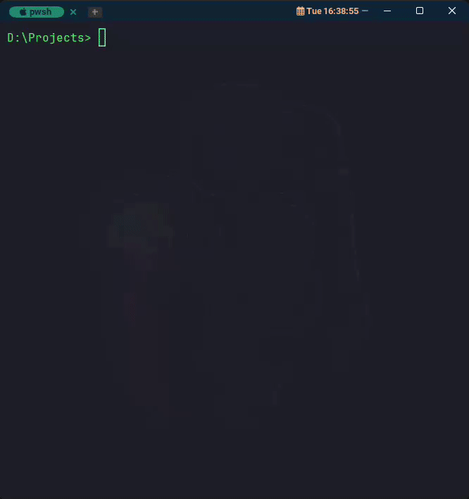

<h1 align="center">del-repos</h1>

<p align="center">
  <a href="./README.md">English</a> | <a href="./README.zh.md">中文</a>
</p>

<p align="center">
  
  
  
  
</p>

<p align="center"></p>

`del-repos` 是一个交互式命令行工具，用于批量选择并永久删除 GitHub 或 Gitee 仓库。它提供仓库搜索、多选、范围筛选、本地令牌保存和逐仓库结果反馈。

> [!WARNING]
> 删除仓库不可恢复。此工具没有 dry-run 或非交互式删除模式。请先备份重要内容，核对终端中打印的仓库列表，只在目标完全正确时确认删除。

## 安装 CLI

### 前置条件

- Node.js 14 或更高版本
- 可交互的终端
- 有权删除目标仓库的 GitHub 或 Gitee 个人访问令牌

使用一种包管理器全局安装：

```bash
npm install --global del-repos
pnpm add --global del-repos
yarn global add del-repos
```

不想全局安装时，可直接运行：

```bash
npx del-repos
```

验证安装：

```bash
del-repos --version
del-repos --help
```

## 使用 CLI

启动交互流程：

```bash
del-repos
```

CLI 会依次：

1. 选择 GitHub 或 Gitee。
2. 没有已保存令牌时，打开对应的令牌创建页面。
3. 按指定范围拉取仓库。
4. 搜索并选择仓库。输入文字搜索，按空格选择或取消选择，按 Enter 提交。
5. 打印已选仓库名称，并请求最终确认。
6. 逐个删除仓库，输出成功和失败汇总。

### 命令选项

| 选项 | 说明 |
| --- | --- |
| `-v`, `--version` | 显示已安装版本。 |
| `-h`, `--help` | 显示帮助。 |
| `-t`, `--type <o\|a>` | 拉取 `o`（本人拥有）或 `a`（全部可访问）仓库。默认 `a`。 |
| `--clear-token` | 清除两个平台已保存的令牌值。 |

示例：

```bash
del-repos --type o
del-repos --type a
del-repos --clear-token
```

`owner` 更适合删除当前登录账号拥有的仓库。`all` 会请求平台 API 返回全部可访问仓库，其中可包含协作者和组织仓库。显示在选择器中不代表一定可以删除：当前 CLI 会以已认证用户名发起删除请求，因此协作者或组织仓库即使可见，也可能删除失败。

## 令牌与本地数据

需要令牌时，CLI 会打开以下页面：

- GitHub：经典个人访问令牌页面，并预选 `repo`、`delete_repo`、`project` 权限。
- Gitee：个人访问令牌页面。请授予仓库删除权限。

选择保存令牌后，CLI 会将其以明文 JSON 写入 `<home>/.del-repos/config.json`，字段为 `github_token` 和 `gitee_token`。请将该文件当作凭证处理：不要提交、分享或以不安全方式备份。`del-repos --clear-token` 会把令牌值替换为 `{}`，不会删除配置文件本身。

## Agent Skill

本仓库还提供 `del-repos` Agent Skill，供 Codex 和兼容智能体在执行删除前确认平台、范围、令牌存储选择与精确目标，并在最终仓库列表出现后请求明确授权。

为 Codex 全局安装：

```bash
npx skills add yaolifeng0629/del-repos --skill del-repos --global --agent codex
```

去掉 `--global` 可仅安装到当前项目。完整说明见 [skills/README.md](skills/README.md)。

## 故障排查

| 现象 | 检查方式 |
| --- | --- |
| `401`、`403`、`Unauthorized` 或 `Forbidden` | 使用 `del-repos --clear-token` 清除保存的值，创建具备所需权限的新令牌，然后重新运行并再次核对仓库选择。 |
| 没有显示仓库 | 确认所选平台、令牌权限、登录账号和仓库范围。 |
| 仓库显示在列表中但删除失败 | 确认已认证账号拥有该仓库且具备删除权限。通过 `--type a` 选中的协作者或组织仓库常会遇到此问题。 |
| 部分删除失败 | 查看每个仓库的结果与最终计数。CLI 遇到单个失败会继续执行，最终的完成提示不等于全部仓库已删除。 |

## 开发

```bash
git clone https://github.com/yaolifeng0629/del-repos.git
cd del-repos
pnpm install
pnpm lint
pnpm build
pnpm dev
```

`pnpm lint` 会执行 TypeScript 编译检查，`pnpm build` 会将 CLI 构建到 `dist/`，`pnpm dev` 会重新构建并运行本地产物。当前仓库没有自动化测试脚本；提交改动前请运行类型检查，并在受控环境完成一次交互式冒烟验证。

## 贡献

请通过 Issue 提交缺陷或建议，并提交范围明确、同步更新文档的 Pull Request。不要在 Issue 或 Pull Request 中提交令牌、仓库清单，或包含私有 URL 的破坏性操作输出。

## 许可证

ISC，详见 [LICENSE](LICENSE)。
